<div align="center">


# Nexus Lounge

**Watch together, wherever you are.**
Voice, chat, synced YouTube, Twitch and Kick, and screen sharing in one shared room. Installs as an app on phones and desktops.

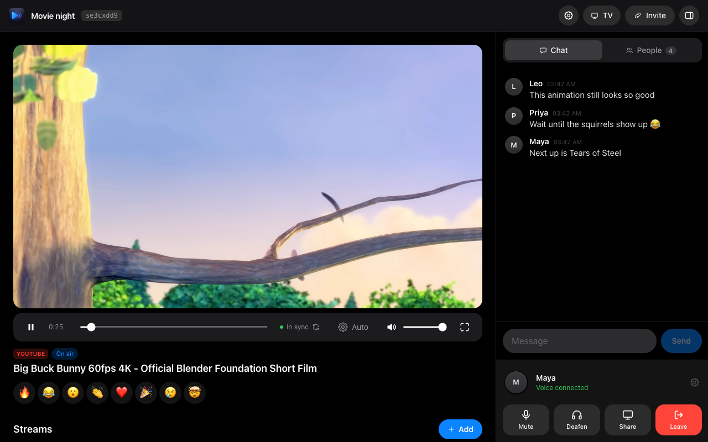

</div>

**Live at [nexuslounge.party](https://nexuslounge.party).**

I built it so my friends and I could watch League of Legends Worlds together, but it's general purpose: sports, premieres, VODs, movie nights.

## Screenshots

| Phone | Phone: streams | Phone: landscape |
| :---: | :---: | :---: |
| 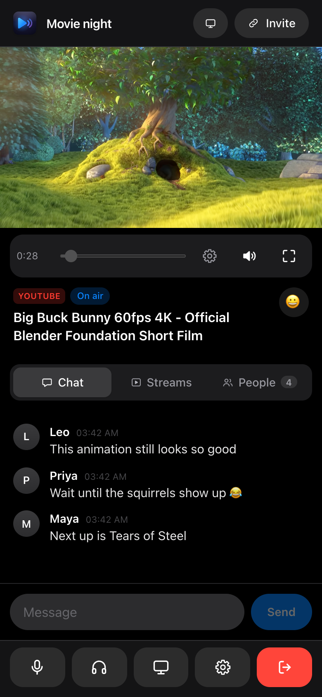 | 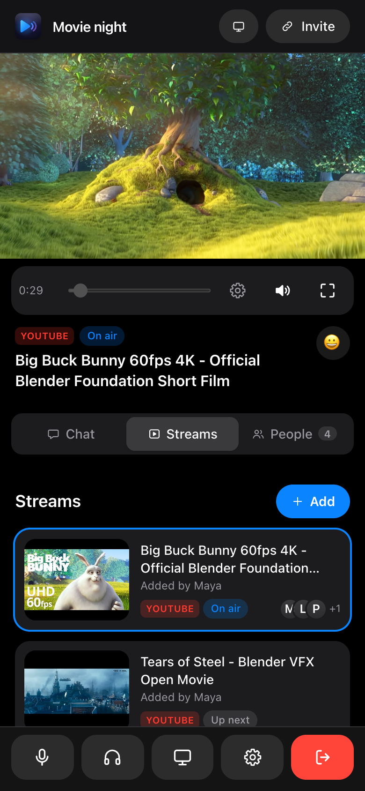 | 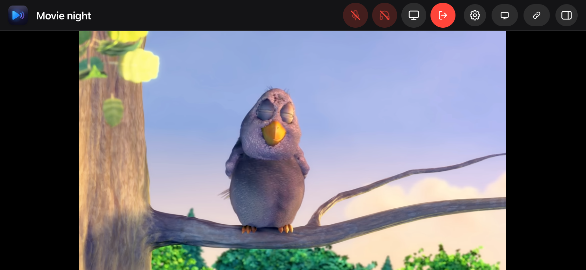 |

| Collapsed side panel | People | Room settings |
| :---: | :---: | :---: |
| 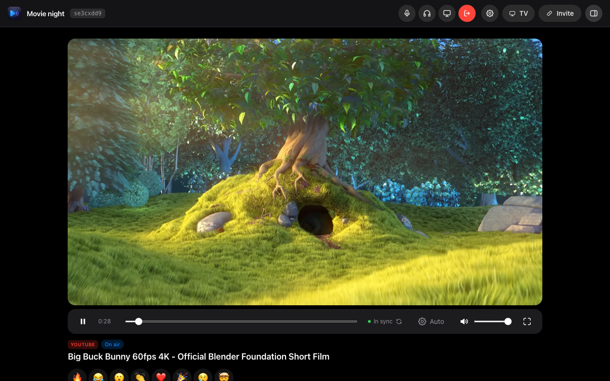 | 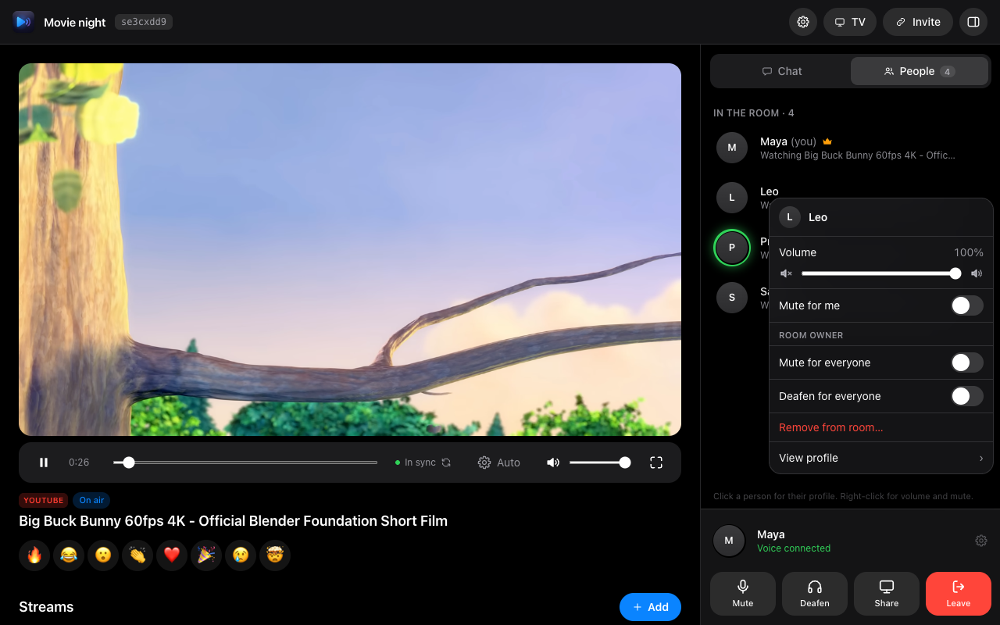 | 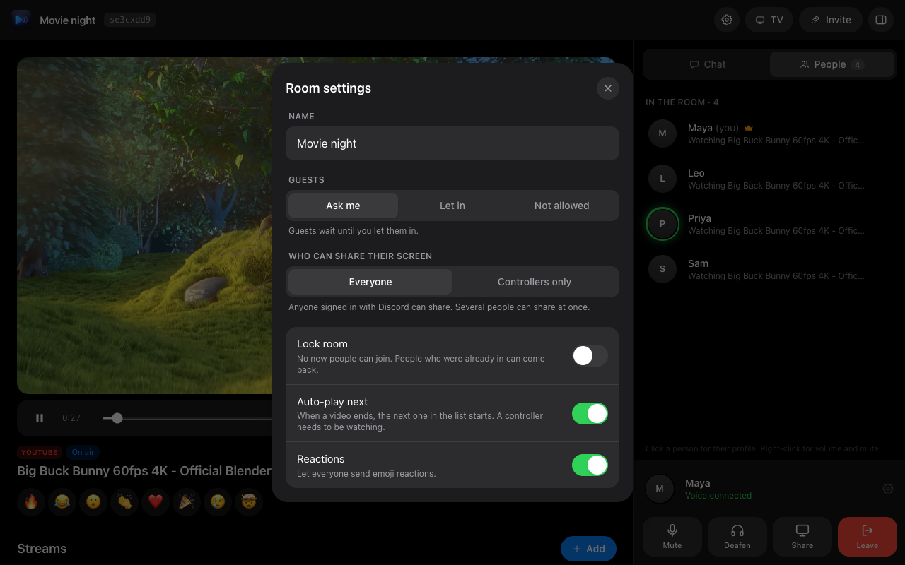 |

| Playlists and queue | Landscape with chat open |
| :---: | :---: |
| 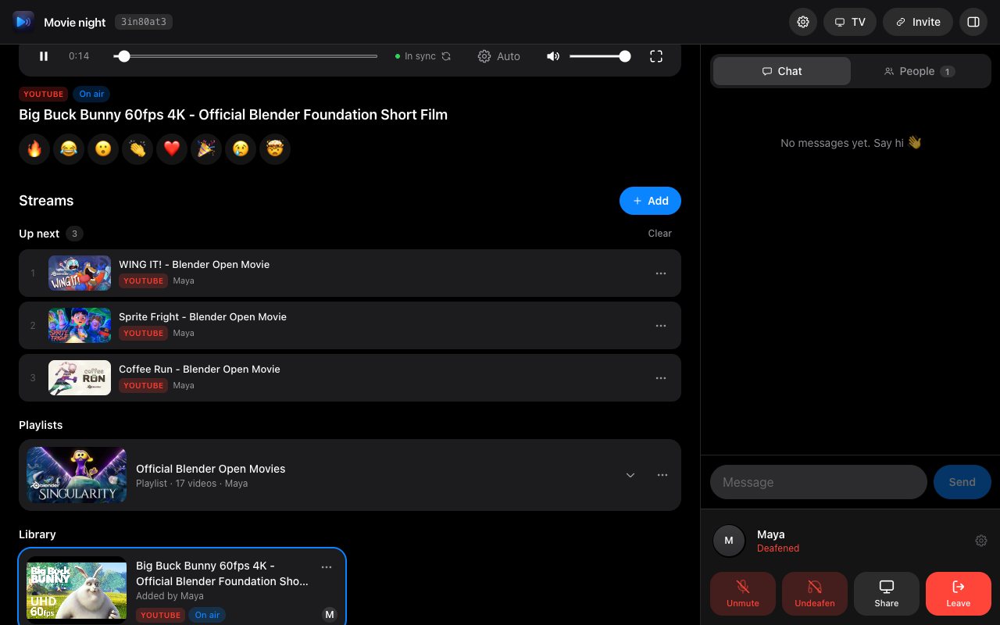 | 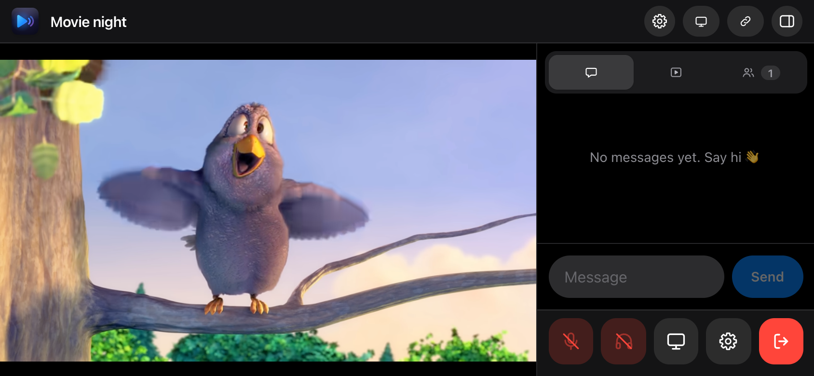 |

| Choose where video plays (TV connected) | Phone player bar: More menu | Account |
| :---: | :---: | :---: |
| 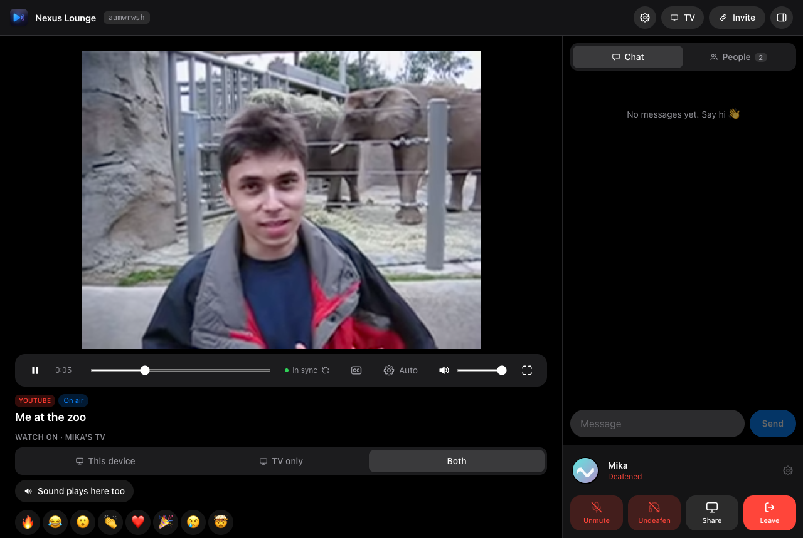 | 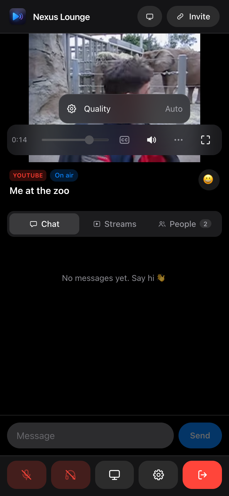 | 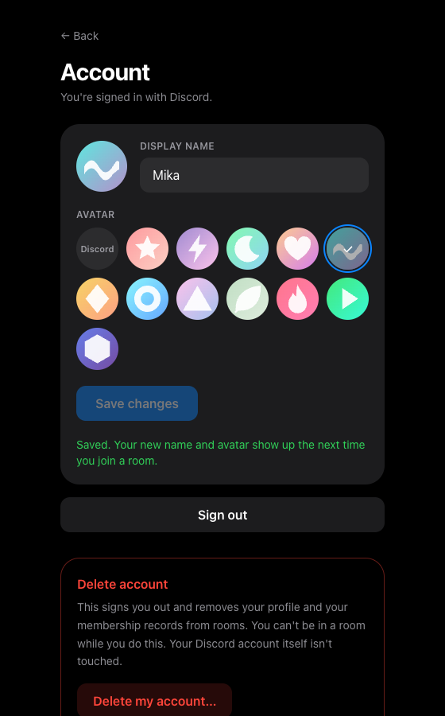 |

<details><summary>TV mode</summary>

</details>

## What you can do

**Rooms and people**
- Create a named room and share the invite link. Sign in with Discord, or join as a guest.
- Guests wait in a lobby until the room owner lets them in. The owner can also remove anyone, who then can't rejoin.
- Room settings (owner): room name, guest policy (ask / let in / not allowed), lock the room, who may share their screen, auto-play next, and reactions on or off.
- Optional room password.
- Roles: the owner can make other Discord users controllers, who can pick what the room watches, control playback, reorder the queue, put a screen share on air, and stop someone's screen share.

**Watching**
- Paste any YouTube, Twitch or Kick link (video, live stream, channel, past broadcast; Kick channels only) to add it to the room's stream list.
- **Queue:** an "Up next" list that everyone sees. Signed-in people add videos to the end or to the front ("Play next"); controllers reorder, play now, remove and clear. When a video ends, the next one in the queue starts (a controller needs to be watching). Live streams can't be queued, and with an empty queue the library order is used.
- **Playlists:** paste a YouTube playlist link and it shows up as one expandable item. Add the whole playlist to the queue, or tick just the videos you want.
- Every stream has its own shared clock, so some people can watch one stream while others watch another, and anyone can switch without losing sync. The owner or a controller can put one stream "on air" for everyone; guests always follow it.
- Playback stays in sync across everyone's devices, with smooth correction instead of constant skipping (on-demand videos; live streams are handled differently, see below).
- Live YouTube streams aren't continuously synced (everyone's live edge differs and a player can only play what it buffered): play and pause are shared, and each viewer jumps once to their own live edge when they join or when a controller acts. **Go live** from a controller sends everyone to the live edge; for everyone else it jumps their own player to theirs.
- Several people can screen share at once, each with audio. Everyone picks which share to watch, and the owner or a controller can put one on air. A notice appears when someone starts sharing.
- **Your own video files:** pick a video from your computer and watch it together. Friends who don't have the file watch a live feed from your browser (no upload: the video never touches the server). Friends who do have the same file can pick it and play their own copy, synced to the room in full quality. Wrong files are refused (a fingerprint of the size and a few slices must match). Chrome and Edge remember the file across a refresh. Sharing the feed works from Chrome, Edge, Firefox and Safari on a computer; TVs always use the feed.
- **Stremio, magnets and video links:** the host and controllers can add a magnet link, a Stremio stream link or a video link (including the signed links debrid and addon services give you). Torrents play through the Stremio app on your computer (`127.0.0.1:11470`, or any address you set); links play straight in the browser when they can, and through Stremio when they can't (insecure `http` redirects, formats your browser can't decode, services that block browsers), which converts them to HLS that plays everywhere. Matroska plays as it is on Chrome and Edge, and HEVC/AC3/E-AC3 are used directly where your browser decodes them. Friends without Stremio watch a live feed from the owner's browser. Friends with Stremio tap **Play with my Stremio** to download the torrent themselves, in sync, with no load on the owner, or paste their own link or magnet to the same video (the size and length must match). Links stay in the owner's tab and are never sent to the room or the server, expired ones can be replaced in place, and error clips from link services are flagged. Chrome and Edge ask once to let the site reach devices on your network. Subtitles (tracks inside the video, files that came with a torrent, a file from your computer, or a search by title through OpenSubtitles) are chosen per person.
- Twitch live channels and Kick channels can't be time-synced by embeds, so the app says so and suggests screen share. Kick links must be channels (kick.com/name); Kick videos and clips are refused.
- Reactions: send emoji that float across the screen for everyone.

**Playback controls**
- Subtitles on YouTube (language list from the video, on/off, text size), remembered between videos.
- Quality: the real list on Twitch, Auto/High/Low on screen shares. YouTube no longer lets embedded players choose a quality, so the menu says so.
- Volume: a perceptual curve, truly silent at the bottom, remembered between sessions.
- AirPlay: screen shares offer the AirPlay picker where Safari supports it; for YouTube, Twitch and Kick (which can't be sent to AirPlay directly) the TV sheet explains how to mirror the clean TV view to an Apple TV.

**Voice and chat**
- Voice joins muted and deafened. Unmuting also undeafens you, and the browser only asks for the microphone at that moment. Mute, deafen, push-to-talk (any key, or hold the mic button) and speaking indicators match what everyone hears.
- Everyone's state is visible to everyone: muted, deafened, muted or deafened by the owner, and who is sharing their screen.
- Click someone for their profile; right-click for per-person volume and "mute for me". The owner can mute or deafen anyone for everyone.
- Text chat in the side panel, with an unread badge.

**Phones and tablets**
- Portrait: the video, tabs and chat stay visible above a compact voice dock, and the player controls float over the video instead of taking space.
- Landscape: a slim header and a full-height video; the side panel (chat, streams, people) opens beside it on demand and the voice controls live in the header.
- Fullscreen everywhere: the browser's Fullscreen API where it exists (desktop, Android, iPad). iPhone has none, so there is an immersive mode, and viewers get YouTube's own controls whose fullscreen button opens iOS's native player (Twitch always has its own). Screen shares go to the native iOS player directly.
- Fit or Fill: in fullscreen (and landscape on a phone) a button switches between showing the whole picture and filling the screen by cropping the edges. It works on desktop too, remembers your choice, and is not offered for Twitch (its own controls would be cropped). In landscape, fullscreen keeps the picture inside the notch's safe area.
- Gestures: double-tap the left or right side of a video to skip 10 seconds (controllers), double-tap the middle (or double-click) for fullscreen, tap to show the controls.
- The screen stays on while you're in a room or TV mode (Screen Wake Lock).
- Installable PWA with an offline page, app shortcuts and install screenshots.

**Desktop**
- Hide the side panel (button or the `\` key) to be fully immersed. Voice controls move into the header and an unread badge keeps you posted on chat.
- Keyboard: `F` fullscreen, `M` mute, and for controllers `Space`/`K` play and pause, `←`/`→` skip 5 seconds, `J`/`L` skip 10 seconds. Shortcuts are ignored while typing.

**Any screen**
- Responsive on phone, tablet, laptop and desktop (including landscape phones).
- Installable as a PWA.
- Accounts: change your display name and avatar, or delete your account (not while in a room), at `/account`. Terms of Service and Privacy Policy are public at `/terms` and `/privacy` (use these URLs in the Discord developer portal).
- TV output: when your own TV is connected you choose where the video plays: this device, the TV only, or both.
- TV mode: open the TV view on a TV browser (enter the code it shows in your room) or cast a browser tab. It shows only the video, with no controls.

## Architecture

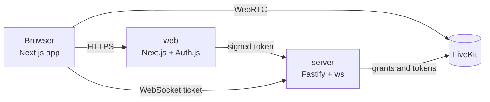

```
apps/web         Next.js app (UI, Discord login via Auth.js, thin API routes)
apps/server      Fastify + ws (rooms in memory, LiveKit tokens, sync WebSocket)
packages/shared  zod schemas, types and the sync maths shared by both
docs/            Railway notes and screenshots
```

## Getting started

**Requirements:** Node 22.18+ (the server runs TypeScript directly), pnpm 10+, and Docker only if you self-host LiveKit locally.

**Setup**

1. `pnpm install`
2. `cp .env.example .env` and fill it in (below).
3. `pnpm dev`, then open http://localhost:3000.

`pnpm dev` starts the web app (port 3000) and the server (port 4000). For local voice, run `pnpm livekit` in another terminal (needs Docker), or use LiveKit Cloud instead.

### Discord credentials

1. Open the [Discord Developer Portal](https://discord.com/developers/applications) and create an application.
2. Under **OAuth2**, copy the Client ID into `DISCORD_CLIENT_ID` and reset/copy the Client Secret into `DISCORD_CLIENT_SECRET`.
3. Add the redirect URL `http://localhost:3000/api/auth/callback/discord` (add your production URL the same way).
4. Generate `AUTH_SECRET` with `openssl rand -base64 32`.

### LiveKit credentials

- **Local (default in `.env.example`)**: `pnpm livekit` runs LiveKit in dev mode with key `devkey` and secret `secret`, at `ws://localhost:7880`.
- **LiveKit Cloud**: create a project at [cloud.livekit.io](https://cloud.livekit.io), then copy the WebSocket URL (`wss://….livekit.cloud`) into `LIVEKIT_URL` and an API key/secret pair from **Settings → Keys** into `LIVEKIT_API_KEY` / `LIVEKIT_API_SECRET`.

## Env vars

| Variable | Used by | Purpose |
| --- | --- | --- |
| `DISCORD_CLIENT_ID`, `DISCORD_CLIENT_SECRET` | web | Discord OAuth |
| `AUTH_SECRET` | web, server | Session encryption and server token signing (must match) |
| `AUTH_URL` | web | Public URL of the web app |
| `LIVEKIT_URL`, `LIVEKIT_API_KEY`, `LIVEKIT_API_SECRET` | server | LiveKit connection and token minting |
| `NEXT_PUBLIC_SERVER_WS_URL` | web | WebSocket URL of the server (`wss://<server>/ws`); the HTTP URL is derived from it |
| `SERVER_WS_URL` | web | Optional runtime override of the above. Next bakes `NEXT_PUBLIC_*` values in at build time, this one is read when the app runs |
| `PORT` | server | Server port (default 4000) |
| `ADMIN_SECRET` | web, server | Optional. 32+ random characters, different from `AUTH_SECRET`; signs admin requests and the admin session cookie |
| `ADMIN_DISCORD_IDS` | web, server | Optional. Comma-separated Discord user IDs allowed to open `/admin` |
| `ADMIN_TOTP_SECRET` | web | Optional. Base32 key for the authenticator app used to unlock `/admin` |

## How it works

- The browser never sends your Discord session to the server. Next API routes sign a short-lived HMAC token (with `AUTH_SECRET`) and call the Fastify server, which verifies it. Joining a room returns a LiveKit token plus a room-scoped ticket for the sync WebSocket.
- Voice, speaking indicators, screen share and chat run through LiveKit. Playback state, the stream list, roles, guest approvals and moderation run over the server's WebSocket, and every message is validated with zod (`packages/shared/src/protocol.ts`).
- Each stream stores `position`, `playing` and a server timestamp. Clients estimate the server clock (median of ping samples) and compute the expected position locally. Drift is the median of the last few readings, small drift is fixed by gently changing playback speed, and seeks are rare and debounced. Add `?debug` to a room URL to see the live numbers.
- Permissions are enforced on the server and in the LiveKit token, not just hidden in the UI: guests can't add streams, share, or create rooms; only the owner can mute, deafen, remove people, let guests in or change room settings; sharing can be limited to controllers.
- Twitch embeds must not be covered by anything on the page (Twitch disables playback if they are), so nothing is ever drawn over a Twitch or Kick player: its own controls are used and our status lines sit below it.
- YouTube titles are fetched server-side from YouTube's public oEmbed endpoint (no key needed).
- Rooms live in server memory and vanish on restart. Redis is the natural next step for persistence and running more than one server instance.

## Tests

```
pnpm typecheck
pnpm --filter @nexus/shared test   # URL parsing, drift maths, live-edge helpers, tokens, sound cues
pnpm --filter @nexus/server test   # spawns the server; permissions, guest approval, removal, moderation,
                                   # late joiners, passwords, tickets, TV pairing over real WebSockets
```

CI runs the same checks plus a production build on every push.

Browser end-to-end suites (Chrome plus WebKit for the iPhone-style checks) live in [`e2e/`](e2e/README.md): rooms, voice, push to talk, fullscreen, the queue and playlists, gestures, phone layouts and "nothing covers the Twitch player".

## Deploy on Railway

Two services built from the Dockerfiles in `apps/server` and `apps/web`, auto-deployed from `main`. LiveKit must be [LiveKit Cloud](https://cloud.livekit.io), since Railway doesn't support UDP. Step-by-step instructions and config templates are in [docs/railway-deploy.md](docs/railway-deploy.md).

Every server deploy or restart ends all rooms, because they live in memory. Keep the server at a single instance.

## License

Copyright (C) 2026 dsameendra

Nexus Lounge is free software under the [GNU Affero General Public License v3.0](LICENSE) (AGPL-3.0-or-later). You can use, modify and host it, but if you run a modified version as a service, you must make your version's source available to its users under the same license. Derivative works must stay open source.

If you like it and want to help with hosting costs, you can support it on [Ko-fi](https://ko-fi.com/dsameendra). It is optional, and a star on the repo helps just as much.
